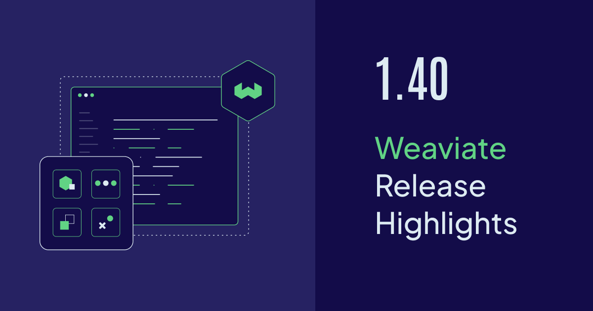
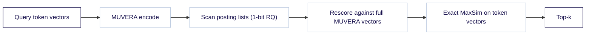

Weaviate `v1.40` is now available open-source and on [Weaviate Cloud](https://console.weaviate.cloud).

Two features reach **general availability** in this release: **dropping a named vector**, which frees the disk and index memory an unused vector was holding, and **4-bit Rotational Quantization**. Two more are new: the HFresh index now takes **multi-vector embeddings** through MUVERA, and **PathSeer** joins ACORN and sweeping as a third filter strategy for HNSW. This post also catches up on the **Search REST API**, which changed a lot over the 1.39 patch line. It also covers a **breaking change to vector configuration defaults** to check before you upgrade.

Here are the release highlights!

{/* TODO(ivan): Python client 4.24.0 is unreleased on 2026-10-14. The drop-vector and PathSeer snippets need it. Re-check before publishing. */}



- [Drop a named vector - General Availability](#drop-a-named-vector---general-availability)
- [4-bit Rotational Quantization - General Availability](#4-bit-rotational-quantization---general-availability)
- [Multi-vector embeddings on HFresh with MUVERA](#multi-vector-embeddings-on-hfresh-with-muvera)
- [PathSeer filter strategy](#pathseer-filter-strategy)
- [Search REST API (Preview)](#search-rest-api-preview)
- [Vector configuration defaults (breaking change)](#vector-configuration-defaults-breaking-change)
- [Performance Improvements and Fixes](#performance-improvements-and-fixes)
- [Community Contributions](#community-contributions)
- [Summary](#summary)

:::caution Breaking change
If your server sets `DEFAULT_VECTORIZER_MODULE`, read [Vector configuration defaults](#vector-configuration-defaults-breaking-change) before you upgrade.
:::

## Drop a named vector - General Availability

Collections pick up vectors over time. You add a named vector to try a new embedding model, the new one wins, and the old one stays on every object, in every shard, taking up disk and index memory. Until now the only way out was to re-create the collection and re-import everything.

`v1.40` makes the **drop vector index** endpoint **generally available**. It has existed since `v1.37` as an experimental feature that was off by default. In `v1.40` it is on by default.

A drop deletes the vector's index and removes its embedding from every object. The collection's other named vectors and all object data stay as they are.

:::caution A drop cannot be undone
To get the vector back, add it again and then re-vectorize or re-import your objects.
:::

### How it works

With the Python client (4.24.0 or newer), call `delete_vector_index` with the name of the vector:

```python
articles = client.collections.use("Article")
articles.config.delete_vector_index("body_vector")
```

Over REST it is one `DELETE` request:

```bash
curl -X DELETE \
  http://localhost:8080/v1/schema/Article/vectors/body_vector/index
```

The call returns once Weaviate has accepted the drop. The cleanup itself runs in the background, shard by shard, and picks up where it left off after a restart.

While the cleanup runs, the vector is still listed in the collection definition, and writes that target it are rejected. In a batch, only the objects that carry the dropped vector fail. The drop is finished when the vector disappears from the definition.

A few more things to know:

- **Permissions:** You need `update` permission on the collection and on its data objects, because a drop rewrites every object.
- **Inactive tenants:** A tenant that is inactive holds up completion until it is activated and a later cleanup round reaches it.
- **Reusing the name:** Once the drop is finished you can add a vector with the same name again, even with a different dimensionality. The new index starts empty.
- **The last vector:** Dropping the only vector leaves a collection with no vectors. Objects and properties stay.

The Python client is the first to wrap the endpoint. From any other language, send the REST request.

{/* TODO(ivan): docs#553 is unmerged, anchor goes live with it */}

:::info Related resources

- [How-to: Manage collections - Drop a named vector](https://docs.weaviate.io/weaviate/manage-collections/vector-config#drop-a-named-vector)
- [References: RESTful API - Schema](https://docs.weaviate.io/weaviate/api/rest#tag/schema)

:::

## 4-bit Rotational Quantization - General Availability

[4-bit Rotational Quantization (RQ)](/blog/weaviate-1-39-release#4-bit-rotational-quantization-preview), a preview in `v1.39`, is now **generally available**. RQ compresses a vector by rotating it and then storing each dimension as a small integer instead of a 32-bit float. At 4 bits, two dimensions fit in one byte.

The numbers carry over from the preview. A 1536-dimension vector takes **784 bytes**, a 16-byte header plus 768 bytes of codes, against 6144 bytes for raw `float32`. That is **7.84x** smaller.

{/* TODO(ivan): docs _includes/feature-notes/rq-4bit.mdx says "Added in v1.40", but the preview shipped in v1.39. Align the note with this post. */}

### How it works

The configuration is the same as in the preview. Set `rq.bits = 4` on an HNSW index:

```python
from weaviate.classes.config import Configure

client.collections.create(
    "Doc",
    vector_config=Configure.Vectors.self_provided(
        name="default",
        vector_index_config=Configure.VectorIndex.hnsw(
            quantizer=Configure.VectorIndex.Quantizer.rq(bits=4),
        ),
    ),
)
```

`bits` is fixed the moment RQ is first enabled on a vector, so pick the width when you create the collection. The default `rescoreLimit` of `20` is unchanged.

An operator can make it the default for every new HNSW index with `DEFAULT_QUANTIZATION=rq-4`. 4-bit is for HNSW only. The flat index, and the flat side of a dynamic index, accept 1-bit and 8-bit RQ.

For the engineering behind it, from the SIMD work to how it compares with other 4-bit schemes, read the [4-bit Rotational Quantization deep dive](/blog/4-bit-rotational-quantization).

:::info Related resources

- [Concepts: Vector quantization - Rotational quantization](https://docs.weaviate.io/weaviate/concepts/vector-quantization#rotational-quantization)
- [How-to: Compression - 4-bit RQ](https://docs.weaviate.io/weaviate/configuration/compression/rq-compression#4-bit-rq)
- [Blog: 4-bit Rotational Quantization](/blog/4-bit-rotational-quantization)

:::

## Multi-vector embeddings on HFresh with MUVERA

[HFresh](/blog/hfresh) is Weaviate's disk-based vector index. It keeps a small index of centroids in memory and stores compressed vectors on disk, so it needs far less memory than HNSW. Until now it only took one vector per object.

Late-interaction models such as ColBERT and ColPali produce a **multi-vector embedding**: one vector per token or image patch, instead of one vector per object. They rank well, but a page of text can turn into hundreds of vectors, which is the kind of data that strains memory. In `v1.40`, HFresh can index them.

There is one condition. On HFresh, multi-vector embeddings need **MUVERA** encoding. MUVERA turns a set of vectors into a single fixed-length vector, so HFresh can search it like any other.

### How it works

A multi-vector query on HFresh runs in three passes:



`searchProbe` and `rq.rescoreLimit`, both set in the HFresh index config, control the first two passes. `searchProbe` sets how many posting lists are scanned. `rq.rescoreLimit` sets how many candidates survive the rescore. The survivors are then scored exactly against their original token vectors with MaxSim. MaxSim is the late-interaction score that matches each query token to its closest document token.

To set it up, create a named vector with no vectorizer, MUVERA encoding, and an HFresh index:

```python
from weaviate.classes.config import Configure

client.collections.create(
    "Page",
    vector_config=Configure.MultiVectors.self_provided(
        name="colbert",
        encoding=Configure.VectorIndex.MultiVector.Encoding.muvera(),
        vector_index_config=Configure.VectorIndex.hfresh(),
    ),
)
```

The constraints:

- **The vector needs `"vectorizer": "none"`:** You bring the token vectors yourself.
- **MUVERA is required, and fixed at creation:** `multivector.muvera.enabled` cannot be changed later.
- **The encoding is always compressed with 1-bit RQ:** PQ, SQ and BQ are rejected, and RQ cannot be turned off.

:::caution `multivector.enabled` alone is not enough on HFresh
If you set `multivector.enabled` without MUVERA, the collection is created, but it behaves as a regular vector without multi-vector support and rejects multi-vector imports and queries. Set `multivector.muvera.enabled`.
:::

:::info Related resources

- [Config references: Multi-vector embeddings on HFresh](https://docs.weaviate.io/weaviate/config-refs/indexing/vector-index#hfresh-multi-vector)
- [Concepts: Multi-vector embeddings on HFresh](https://docs.weaviate.io/weaviate/concepts/vector-index#multi-vector-embeddings-on-hfresh)
- [How-to: Multi-vector compression - MUVERA encoding](https://docs.weaviate.io/weaviate/configuration/compression/multi-vectors#muvera-encoding)
- [Blog: HFresh, memory-efficient vector search](/blog/hfresh)

:::

## PathSeer filter strategy

A filtered vector search has to find the nearest objects that also pass a filter. On an HNSW index, the `filterStrategy` setting decides how the search walks the graph when many neighbors fail the filter. Until now you had two choices: `acorn` (the default) and `sweeping`.

`v1.40` adds a third, **`pathseer`**. It comes from the [SIGMOD 2026 paper](https://doi.org/10.1145/3802098) by Zhiyue Li et al., and the paper's first author, [@lizhiyuell](https://github.com/lizhiyuell), contributed the implementation ([#12137](https://github.com/weaviate/weaviate/pull/12137)).

In Weaviate's benchmarks PathSeer was the fastest strategy, or within a few percent of it, on random, topical and combined filters. ACORN stays ahead only on strongly negatively correlated filters, where the filter all but excludes the query's neighborhood. The [PathSeer post](/blog/pathseer-filtered-vector-search) has the full benchmarks and a walkthrough of the algorithm.

### How it works

PathSeer walks the bottom layer of the graph like sweeping. While the result set is still filling, it also filter-checks the neighbors of each candidate's neighbors, like ACORN. Once the result set is full, it skips the non-matching neighbors of a non-matching candidate without computing their distance. It makes that call per node, so there is no new parameter to tune.

It stores nothing extra. There is no import cost, no memory overhead, and you can switch an existing collection to it, or away from it, without reindexing. The flat-search cutoff still applies first: when a filter matches fewer objects than `flatSearchCutoff`, Weaviate scans those objects instead of walking the graph.

To switch an existing named vector over:

```python
from weaviate.classes.config import Reconfigure, VectorFilterStrategy

articles = client.collections.use("Article")
articles.config.update(
    vector_config=Reconfigure.Vectors.update(
        name="default",
        vector_index_config=Reconfigure.VectorIndex.hnsw(
            filter_strategy=VectorFilterStrategy.PATHSEER,
        ),
    )
)
```

In a collection definition sent over REST, it is one field in the HNSW `vectorIndexConfig`:

```json
{ "vectorIndexConfig": { "filterStrategy": "pathseer" } }
```

:::info Related resources

- [Concepts: Filtering - PathSeer](https://docs.weaviate.io/weaviate/concepts/filtering#pathseer)
- [Blog: PathSeer, adaptive filtered vector search](/blog/pathseer-filtered-vector-search)

:::

## Search REST API (Preview)

The [Search REST API](/blog/weaviate-1-39-release#search-rest-api-experimental) lets you search with plain JSON over HTTP/1.1, with no generated client and no GraphQL query strings. It arrived as an experimental, off-by-default feature in `v1.39`. A lot has changed since then. All of it shipped in 1.39 patches, and the API is now a **preview**.

- **On by default from `v1.39.7`**
- **Structured references from `v1.39.3`:** A new `returnReferences` field replaces the dotted `"hasAuthor.name"` form the 1.39 post warned about. A dotted name in `returnProperties` is now rejected.
- **`near-vector` from `v1.39.8`:** It takes a vector you supply, so it works on collections without a vectorizer.

That makes six endpoints:

- `POST /v1/search/{collection}/near-text`
- `POST /v1/search/{collection}/bm25`
- `POST /v1/search/{collection}/hybrid`
- `POST /v1/search/{collection}/near-object`
- `POST /v1/search/{collection}/near-vector`
- `POST /v1/aggregate/{collection}` (returns a count)

### How it works

Here is a `near-vector` search that also follows a reference to each book's author:

```bash
curl -s -X POST http://localhost:8080/v1/search/Book/near-vector \
  -H 'Content-Type: application/json' \
  -d '{"vector":[0.1,0.9,0.2],"limit":1,
       "returnProperties":["title"],
       "returnReferences":[{"linkOn":"writtenBy","returnProperties":["name"]}],
       "returnMetadata":["distance"]}'
```

Each `returnReferences` entry names the reference property in `linkOn` and what to return from the objects it points to. You can also set `targetCollection` for a multi-target reference, `returnMetadata` for the referenced objects, and a nested `returnReferences` to go one hop further. Referenced objects come back in the same `properties` and `metadata` shape as the top-level hits:

```json
{
  "results": [
    {
      "id": "ce442a4d-a704-46bd-b5c3-cf7b1b2ffdc0",
      "metadata": { "distance": 0.00040352345 },
      "properties": { "title": "The Left Hand of Darkness" },
      "references": {
        "writtenBy": [ { "properties": { "name": "Ursula K. Le Guin" } } ]
      }
    }
  ],
  "tookMs": 1
}
```

A few things have not changed. The default `limit` is `QUERY_DEFAULTS_LIMIT` (10). `targetVector` takes a single vector name. No client library wraps these endpoints yet. Boost, MMR, reranking, generative search and grouped search are not available over REST.

:::caution Preview
The Search REST API is a **preview** feature. Its request and response shape may still change in future releases.
:::

:::info Related resources

- [References: RESTful API - Search endpoints](https://docs.weaviate.io/weaviate/api/rest#tag/search)

:::

## Vector configuration defaults (breaking change)

:::caution Check this before you upgrade
If your server sets `DEFAULT_VECTORIZER_MODULE`, collections you create on `v1.40` without naming a vectorizer will **not** be vectorized. There is no error at creation time, only a warning at startup.
:::

From `v1.40`, `DEFAULT_VECTORIZER_MODULE` is deprecated and ignored. Weaviate logs a warning at startup if it is set. The default top-level `vectorizer` is always `none`. Existing collections are not affected. What changes is what a new collection definition gives you:

| Your collection definition sets | Before `v1.40` | From `v1.40` |
| :-- | :-- | :-- |
| No vector parameters at all | A single-vector collection, filled in from the server defaults | A collection without a vector |
| `vectorIndexType` or `vectorIndexConfig`, but no `vectorizer` | A single-vector collection, vectorized by `DEFAULT_VECTORIZER_MODULE` | A single-vector collection that does not vectorize |
| An explicit vectorizer | Unchanged | Unchanged |

Older clients that always send `vectorIndexType`, such as the Python client before `4.21.2`, land in the second row. Auto-schema changed earlier: since `v1.39.1` it creates a named vector called `default` with the vectorizer set to `none`.

**What to do:** name the vectorizer explicitly in every collection definition that needs one, before you upgrade.

:::info Related resources

- [Migration guide: Vector configuration defaults](https://docs.weaviate.io/deploy/migration#vector-config-defaults)
- [Config references: Collections without a vector](https://docs.weaviate.io/weaviate/config-refs/collections#no-vector)

:::

## Performance Improvements and Fixes

Beyond the headline features, `v1.40` ships a long list of improvements. Some of the items below first shipped in 1.39 patches, and those say so. A few worth calling out:

- **Shard status per replica:** `GET /v1/schema/{collection}/shards` now reports a `per_node_status` object that maps each node to the shard's status on that node. A replica that cannot be reached, or cannot serve reads, reports `UNAVAILABLE`. The old `status` and `vectorQueueSize` fields are deprecated.
- **Stricter MCP hybrid tool:** the built-in MCP server's hybrid search tool now rejects an `alpha` outside `0` to `1` and a negative `limit`. It combines results with relative score fusion, the same default as the other APIs, and it rejects unknown argument keys.
- **gRPC for Google Cloud Storage backups:** the `backup-gcs` module now talks to GCS over gRPC by default. A local emulator that only serves the JSON API needs `GCS_MODULE_TRANSPORT=http`.
- **Smaller HNSW graph in memory:** each HNSW node is now a single heap object instead of three, which means less memory per node and fewer allocations. Shipped in `v1.39.6`.
- **Leaner aggregations:** aggregation scans now reuse their buffers and read each segment through a single reader, so they allocate much less. Shipped in `v1.39.3`.
- **A `read_backups` permission:** a role can now list backups and read backup and restore status without being able to create, restore or cancel one. Shipped in `v1.39.10`.
- **Two new generative modules:** [DigitalOcean](https://docs.weaviate.io/weaviate/model-providers/digitalocean/generative) arrived in `v1.39.2` and [Meta AI](https://docs.weaviate.io/weaviate/model-providers/meta/generative) in `v1.39.3`.

:::info Related resources

- [Weaviate 1.40: GitHub Release Notes](https://github.com/weaviate/weaviate/releases/tag/v1.40.0)

:::

## Community Contributions

Weaviate is open source, and this release cycle includes work from four first-time contributors. Thank you to:

- [@lizhiyuell](https://github.com/lizhiyuell): the PathSeer filter strategy for HNSW ([#12137](https://github.com/weaviate/weaviate/pull/12137))
- [@hamodywe](https://github.com/hamodywe): fetching `Boost.Depth`-deep candidates in hybrid sub-searches ([#12537](https://github.com/weaviate/weaviate/pull/12537)) (since `v1.39.1`)
- [@bharadwaj-pendyala](https://github.com/bharadwaj-pendyala): excluding LSM scratch files from the `offload-s3` shard upload ([#12884](https://github.com/weaviate/weaviate/pull/12884))
- [@ColtonRobak](https://github.com/ColtonRobak): passing the tenant to the re-vectorize check on `PATCH` ([#13345](https://github.com/weaviate/weaviate/pull/13345)) (since `v1.39.8`)

If you'd like to contribute, check out the [contributor guide](https://docs.weaviate.io/contributor-guide/) and the [`good-first-issue`](https://github.com/weaviate/weaviate/issues) label on GitHub.

## Summary

Weaviate `v1.40` promotes two features to general availability, brings multi-vector embeddings to HFresh, and adds a third HNSW filter strategy.

**Key highlights:**

- **Drop a named vector (GA)**: remove a vector you no longer need from every object, in the background, without re-creating the collection
- **4-bit Rotational Quantization (GA)**: the 1.39 preview width is now stable, 7.84x smaller than raw `float32`, on HNSW indexes
- **Multi-vector embeddings on HFresh with MUVERA**: ColBERT and ColPali style embeddings on the disk-based index, through MUVERA encoding
- **PathSeer filter strategy**: a third way to walk the HNSW graph under a filter, from a SIGMOD 2026 paper, switchable on existing collections
- **Search REST API (Preview)**: on by default, structured references, and a `near-vector` endpoint, all since the 1.39 patch line
- **Vector configuration defaults (breaking change)**: `DEFAULT_VECTORIZER_MODULE` is ignored, so name your vectorizer in every collection definition before you upgrade

**Ready to get started?**

The release is available open-source on [GitHub](https://github.com/weaviate/weaviate/releases/tag/v1.40.0) and on [Weaviate Cloud](https://console.weaviate.cloud/), where you can spin up a cluster on the free tier.

:::note
Not all features may be available on Weaviate Cloud. Preview and experimental features, and anything that needs specific environment configuration, may not be enabled on managed clusters, or may arrive there on a different schedule.
:::

If you are upgrading a self-hosted cluster, check the [migration guide](https://docs.weaviate.io/deploy/migration#general-upgrade-instructions) for version-specific notes.

Thanks for reading, and happy vector searching!
