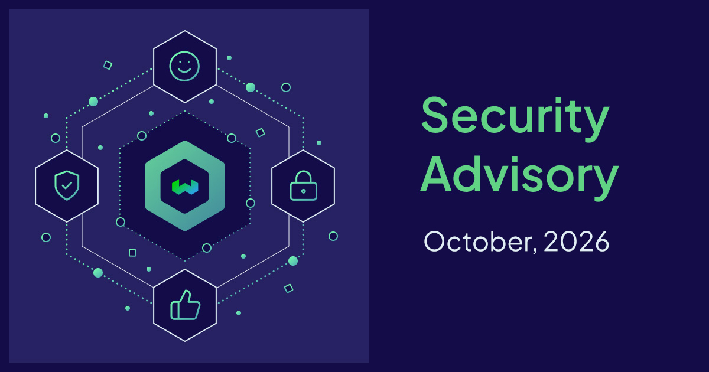

Yesterday, the engineering team at Weaviate patched our entire customer estate and infrastructure platform to mitigate the risk of eight leaked certificates from the certificate authority eMudhra. While the end-to-end process took us less than 17 hours, and our Enterprise customers were patched within six hours, that's only half of the story.

What was particularly amazing about yesterday's patching effort was that a task force of colleagues from all our engineering teams (our core developers, console, platform and agents teams) and our product support function came together to co-ordinate rolling almost every byte of our environment to Go version 1.27.3. As one team, we created and reviewed pull requests, pushed tags, watched promotions and saw the tests of our services pass.

The security and reliability of our database is paramount to us, and we understand that it is this foundation upon which all of our customer trust is built. It is inspiring watching the Weaviate engineering team at work; from our applied research team who live on the bleeding edge of what is possible with AI, to our platform engineers who manage complex compute, security, observability and deployment infrastructure across three cloud providers, and everyone in between.

## Reporting Security Issues

If you think you have found a security vulnerability, please go to our [Security Report page](https://weaviate.io/security-report) to learn how to send us a report. Weaviate will contact you to acknowledge your report, and advise on next steps. We ask that researchers do not disclose vulnerabilities publicly until they have been fixed and announced, unless you have received a response from the Weaviate security team that you can do so.

import WhatNext from "/_includes/what-next.mdx";

<WhatNext />
