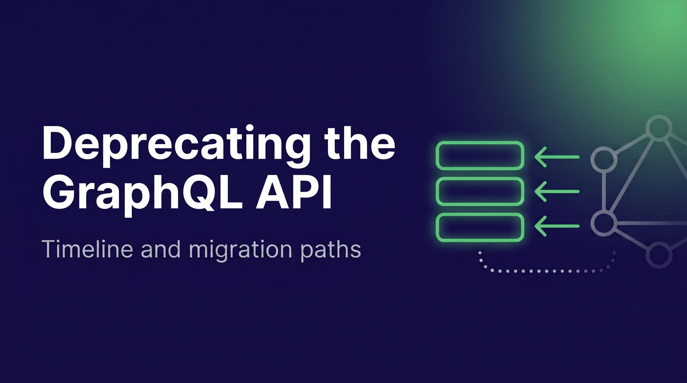

import Tabs from "@theme/Tabs";
import TabItem from "@theme/TabItem";

{/* TODO(ivan): Before publishing, switch every docs-graphql-deprecation--docs-weaviate-io.netlify.app link back to docs.weaviate.io. */}



GraphQL was Weaviate's [first query API](/blog/graphql-api-design), and many of you have built on it since our earliest releases. Today we are deprecating it. **Nothing breaks today. Clusters that use GraphQL keep it until May 1, 2027**, the end-of-life date for GraphQL on Weaviate Cloud. We can help you through the migration. Contact our support team through the [support portal](https://support.weaviate.io/) or at [support@weaviate.io](mailto:support@weaviate.io), whatever your setup looks like. The [GraphQL migration guide](https://docs-graphql-deprecation--docs-weaviate-io.netlify.app/weaviate/api/graphql/migration) walks you through the move, and this post explains why, what happens when, and what your options are.

<!-- truncate -->

:::info In short

- The GraphQL API is deprecated as of October 26, 2026. Nothing breaks on that day.
- Weaviate Cloud switches GraphQL off on all clusters on May 1, 2027. May 1, 2027 is the end-of-life date for GraphQL on Weaviate Cloud. If your cluster has not used GraphQL in the last 30 days, it is switched off on December 1, 2026. New Weaviate Cloud clusters are already created without GraphQL.
- We are emailing all Weaviate Cloud customers so you know whether your clusters are affected.
- If you are on Weaviate Cloud and need help, contact support through the [support portal](https://support.weaviate.io/) or at [support@weaviate.io](mailto:support@weaviate.io).
- Every Weaviate version released before May 1, 2027 keeps a working GraphQL API. The first minor release after that date disables it by default, and you can switch it back on. It is removed in a later release.
- If your application searches through a current Python, TypeScript, Java or C# client, you are most likely not affected. Everyone else should follow the [migration guide](https://docs-graphql-deprecation--docs-weaviate-io.netlify.app/weaviate/api/graphql/migration).

:::

## Timeline

![Timeline: September 30, 2026, new Weaviate Cloud clusters are created without GraphQL. October 26, 2026, GraphQL is deprecated and nothing changes in Weaviate Cloud or self-hosted Weaviate. December 1, 2026, GraphQL is switched off on Weaviate Cloud clusters that do not use it. May 1, 2027, GraphQL is switched off on all remaining Cloud clusters. The first minor release after May 1, 2027 disables GraphQL by default in self-hosted Weaviate, where you can switch it back on. A later release fully removes GraphQL from Weaviate.](./img/timeline.png)
{/* TODO(ivan): Regenerate timeline.png with these milestones: September 30, 2026 (new Cloud clusters created without GraphQL). October 26, 2026 (GraphQL deprecated). December 1, 2026 (Cloud clusters that have not used GraphQL in the last 30 days switched off). May 1, 2027 (all remaining Cloud clusters switched off, self-hosted keeps working until at least this date). First minor release after May 1, 2027 (self-hosted disabled by default, can be switched back on). A later release (GraphQL removed). */}

## Are you affected?

This only affects you if you send queries to Weaviate over GraphQL. Here is how to tell whether you do.

Your own code sends GraphQL:

- It sends HTTP requests to `/v1/graphql` directly.
- It calls a raw GraphQL helper in a client, such as `graphql_raw_query()` in Python.
- Browser code in your application posts GraphQL queries.

A client or tool sends it for you:

- An older client: the Python v3 API (`weaviate.Client`), `weaviate-ts-client` v2, or the Java client v5 and earlier.
- The Go client. The stable v5 client queries over GraphQL. The [v6 client](https://docs.weaviate.io/weaviate/client-libraries/go/go-v6) uses gRPC and is a release candidate today.
- A no-code or BI tool that sends GraphQL to your cluster.

The guide explains how to [find your GraphQL usage](https://docs-graphql-deprecation--docs-weaviate-io.netlify.app/weaviate/api/graphql/migration#find-your-graphql-usage).

If you reach Weaviate through a framework such as LangChain or LlamaIndex, use the official Weaviate integration built on a current client. A community package may still send GraphQL.

## Modernizing Weaviate's query API

GraphQL served Weaviate and its users well for a long time. It gave you one readable language for every kind of search, and a lot of what you built on Weaviate went through it. We are proud of that work. We are moving to one modern query API, and here is what you gain:

- **Speed:** gRPC sends binary Protocol Buffers over HTTP/2, so queries use less bandwidth and return faster than JSON over HTTP. The [gRPC performance post](/blog/grpc-performance-improvements) has the measurements.

- **Clear contracts:** Typed messages give every client typed results and generated request objects, so there is no query string to assemble and no nested JSON to parse. Errors arrive as real status codes, not as HTTP `200` with an `errors` array. Metadata is a field on the result, not a separate `_additional` block.

- **Security that fits fine-grained access:** GraphQL introspection needs read permission on every collection. That does not fit role-based access control (RBAC) with per-collection permissions. The gRPC and REST APIs check exactly the collection you query.

- **Built for how queries are written today:** GraphQL's strength was a query language you could read and type by hand. Today most queries are built by client libraries, frameworks and agents. A compact binary protocol and a plain JSON API serve them better than a hand-written query language.

One API also means every search feature is built, tested and documented once, which lets us ship improvements faster.

## What to use instead

### Client libraries (recommended)

The current Python, TypeScript, Java and C# clients search over gRPC, and they are the path we recommend. If you use Go, the move is to the [v6 client](https://docs.weaviate.io/weaviate/client-libraries/go/go-v6), which uses gRPC and is a release candidate today. The stable v5 client still queries over GraphQL. See [client libraries](https://docs-graphql-deprecation--docs-weaviate-io.netlify.app/weaviate/api/graphql/migration#client-libraries-recommended) in the guide.

### TypeScript web client

For browsers and edge runtimes that cannot open a native gRPC connection, the TypeScript web client (`@weaviate/web`) uses gRPC-Web. It is available now, with the same API as the Node client. See the [TypeScript client for web](https://docs-graphql-deprecation--docs-weaviate-io.netlify.app/weaviate/api/graphql/migration#typescript-client-for-web).

### REST Search API

For stacks that cannot run a client at all, the [REST Search API](https://docs-graphql-deprecation--docs-weaviate-io.netlify.app/weaviate/api/graphql/migration#rest-search-api) offers plain JSON endpoints for search and aggregation (see the [REST API reference](https://docs-graphql-deprecation--docs-weaviate-io.netlify.app/weaviate/api/rest#tag/search)). It is in Preview today. It is a subset of what GraphQL offers, so check the [queries without a REST equivalent yet](https://docs-graphql-deprecation--docs-weaviate-io.netlify.app/weaviate/api/graphql/migration#queries-without-a-rest-equivalent-yet) before you start.

A few GraphQL-only features have no equivalent today. The guide lists them under [GraphQL features without an equivalent](https://docs-graphql-deprecation--docs-weaviate-io.netlify.app/weaviate/api/graphql/migration#graphql-features-without-an-equivalent). We are committed to covering what our customers need. If anything you rely on is not covered, reach out to support and we will work on adding it.

## How to migrate

The [migration guide](https://docs-graphql-deprecation--docs-weaviate-io.netlify.app/weaviate/api/graphql/migration) maps GraphQL queries to their replacements. There are six months between the deprecation and the end of life on Weaviate Cloud, so you can plan the move around your own releases. And you can switch GraphQL off on your own instance today, so you find out if anything breaks.

1. **Find your GraphQL calls:** Search your code, proxies and tools for `/v1/graphql` and raw GraphQL helpers. See [find your GraphQL usage](https://docs-graphql-deprecation--docs-weaviate-io.netlify.app/weaviate/api/graphql/migration#find-your-graphql-usage).
2. **Pick a path:** Use a client library where you can, the TypeScript web client in the browser, and the REST Search API where neither fits. The guide has a [decision table](https://docs-graphql-deprecation--docs-weaviate-io.netlify.app/weaviate/api/graphql/migration#who-this-guide-is-for) for this.
3. **Convert your queries:** Use the [Migration guide](https://docs-graphql-deprecation--docs-weaviate-io.netlify.app/weaviate/api/graphql/migration) to map existing GraphQL queries to alternative methods.
4. **Verify with GraphQL disabled:** Run your application against a Weaviate instance with GraphQL turned off. On Weaviate Cloud, contact support and we switch GraphQL off on a cluster of your choice so you can test. See [test with GraphQL disabled](https://docs-graphql-deprecation--docs-weaviate-io.netlify.app/weaviate/api/graphql/migration#test-with-graphql-disabled).

<details>
  <summary>One query, four ways</summary>

Here is one near-text search on a `Movie` collection, written four ways: five "space opera" movies from 1980 or later in the `scifi` category, with title, year and distance.

<Tabs groupId="languages">
<TabItem value="graphql" label="GraphQL (deprecated)">

```graphql
{
  Get {
    Movie(
      nearText: { concepts: ["space opera"] }
      limit: 5
      where: {
        operator: And
        operands: [
          { path: ["year"], operator: GreaterThanEqual, valueInt: 1980 }
          { path: ["category"], operator: Equal, valueText: "scifi" }
        ]
      }
    ) {
      title
      year
      _additional {
        distance
      }
    }
  }
}
```

</TabItem>
<TabItem value="py" label="Python client">

```python
from weaviate.classes.query import Filter, MetadataQuery

movies = client.collections.use("Movie")

response = movies.query.near_text(
    query="space opera",
    limit=5,
    filters=(
        Filter.by_property("year").greater_or_equal(1980)
        & Filter.by_property("category").equal("scifi")
    ),
    return_properties=["title", "year"],
    return_metadata=MetadataQuery(distance=True),
)

for o in response.objects:
    print(o.properties, o.metadata.distance)
```

</TabItem>
<TabItem value="ts-web" label="TypeScript web client">

```ts
import weaviate, { Filters } from "@weaviate/web";

const client = await weaviate.connectToWeaviateCloud(WEAVIATE_URL, {
  authCredentials: new weaviate.ApiKey(WEAVIATE_API_KEY),
});

const movies = client.collections.use("Movie");

const response = await movies.query.nearText("space opera", {
  limit: 5,
  filters: Filters.and(
    movies.filter.byProperty("year").greaterOrEqual(1980),
    movies.filter.byProperty("category").equal("scifi"),
  ),
  returnProperties: ["title", "year"],
  returnMetadata: ["distance"],
});

for (const o of response.objects) {
  console.log(o.properties, o.metadata?.distance);
}
```

</TabItem>
<TabItem value="rest" label="REST Search API">

`POST /v1/search/Movie/near-text`

```json
{
  "query": ["space opera"],
  "limit": 5,
  "where": {
    "operator": "And",
    "operands": [
      { "path": ["year"], "operator": "GreaterThanEqual", "valueInt": 1980 },
      { "path": ["category"], "operator": "Equal", "valueText": "scifi" }
    ]
  },
  "returnProperties": ["title", "year"],
  "returnMetadata": ["distance"]
}
```

</TabItem>
</Tabs>
</details>

### Self-hosted Weaviate

You can test today. Set the `DISABLE_GRAPHQL` environment variable to `true` and restart Weaviate to disable GraphQL. It is also available as the [runtime-config](https://docs.weaviate.io/deploy/configuration/env-vars/runtime-config) key `disable_graphql`.

With GraphQL disabled, `POST /v1/graphql` and `POST /v1/graphql/batch` return HTTP `422`:

```json
{ "error": [{ "message": "graphql api is disabled" }] }
```

Every Weaviate version released before May 1, 2027 keeps a working GraphQL API. The first minor release after that date disables it by default, and you can switch it back on while you finish migrating. We will remove it in a later release, and we have not set that date yet.

### Weaviate Cloud

Weaviate Cloud switches GraphQL off in two steps. On December 1, 2026, we switch it off on clusters that have not used GraphQL in the last 30 days, since nothing on them depends on it. On May 1, 2027, we switch it off on all remaining clusters. May 1, 2027 is the end-of-life date for GraphQL on Weaviate Cloud. New clusters are already created without GraphQL.
{/* TODO(ivan): Align the 30-day window with the number Brandon and Dirk settle on for the emails. */}

If your cluster is scheduled for December 1 and you believe it still needs GraphQL, contact support and we switch it off later. If you want to test earlier, support can switch it off on a cluster of your choice.

Once GraphQL is switched off on your cluster, GraphQL requests fail the same way they do with `DISABLE_GRAPHQL` set: HTTP `422` with `graphql api is disabled`. To see how your application behaves before then, test it against a self-hosted instance or a new cluster, which is created without GraphQL.

Weaviate Cloud and Enterprise customers who need help planning the move can contact us through the [support portal](https://support.weaviate.io/) or at [support@weaviate.io](mailto:support@weaviate.io).

## Get help

We will get you through this migration. Whatever your setup, and even if you do not know where your GraphQL requests come from, contact support and we work it out with you. If a query or feature you rely on has no equivalent yet, tell us and we will try to add what is missing.

- **Support, for everyone:** Reach our support team through the [support portal](https://support.weaviate.io/) or at [support@weaviate.io](mailto:support@weaviate.io).
- **Community questions:** Ask on the [Weaviate forum](https://forum.weaviate.io/).

import WhatsNext from "/_includes/what-next.mdx";

<WhatsNext />
