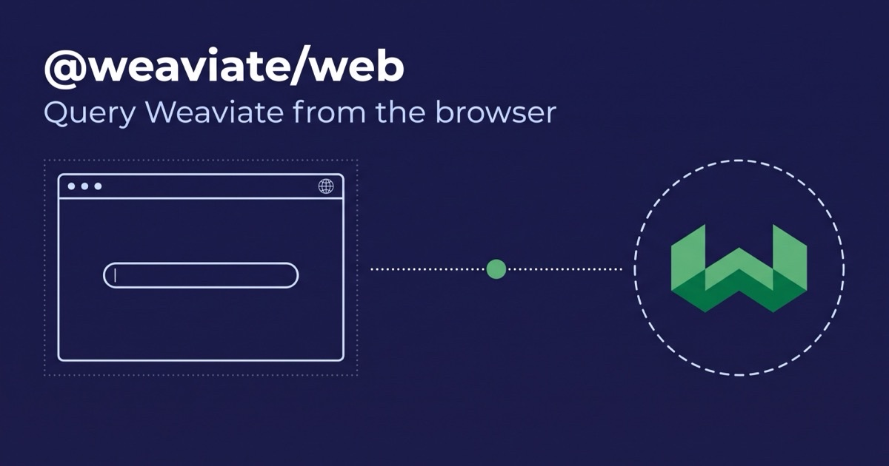
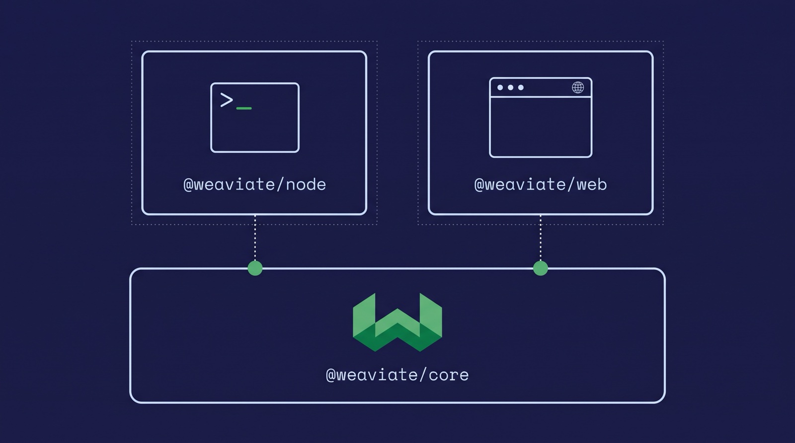
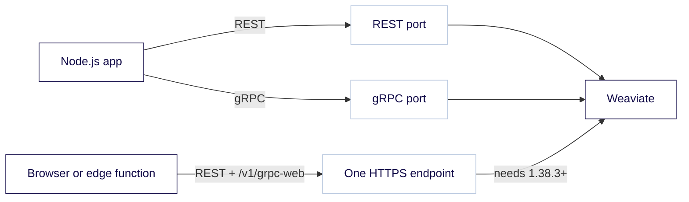

{/* TODO(Ivan): set the publish date here and in the folder name */}

import Tabs from '@theme/Tabs';
import TabItem from '@theme/TabItem';



You built semantic search for your docs site, and it works from a Node script. Then you move the query into the component that renders the search box, and the client will not connect. So the query goes back behind an API route, and now you run a server whose only job is to forward one request. **`@weaviate/web` is the Weaviate web client.** It is the TypeScript client you already know, built to query Weaviate from the browser and from edge runtimes over one HTTPS endpoint. It is generally available.

:::info In short

- Install it with `npm install @weaviate/web`. It is generally available from version 3.15.
- It has the same API as the Node.js client, `@weaviate/node`, so your query code carries over.
- It connects to one HTTPS endpoint. There is no gRPC port to configure.
- It needs Weaviate 1.38.3 or later.
- In a browser, use an API key with read-only permissions.
- Start with the [web client docs](https://docs.weaviate.io/weaviate/client-libraries/typescript/web-client).

:::

## One client, three packages

The TypeScript client now ships as three packages. `@weaviate/node` is for Node.js and supports both ESM and CommonJS. `@weaviate/web` is for browsers and edge runtimes. `@weaviate/core` is the shared base that both build on, and apps do not install it directly. All three share one version number, and 3.15 is the first release with the split. `weaviate-client`, the previous package name, is still released for a transition period. The [TypeScript client page](https://docs.weaviate.io/weaviate/client-libraries/typescript) has the full package table.



## Why does Weaviate need a web client?

In June 2024 the v3 TypeScript client moved its reads and writes to [gRPC](https://grpc.io/), a binary protocol that runs over HTTP/2. That made the client faster. It also made the client server-only, because browser JavaScript cannot open a native gRPC connection. The [v3 GA post](/blog/typescript-client-stable-release) was open about that trade-off: "we found it fitting to keep supporting the v2 client until we have a web version out." It also named the plan: "Our plan is to launch a web version of the client and gracefully sunset the v2 client."

That web version is here.

Until now, a browser app had two options. It could route every query through a backend that ran the Node client. Or it could post GraphQL straight from the page. The second option now has an end date. The GraphQL API is [deprecated as of October 26, 2026](/blog/graphql-api-deprecation), and that post already sends browser and edge developers to the web client.

Edge runtimes such as Cloudflare Workers and Vercel Edge Functions had the same gap. They run your code close to your users, and they cannot open a plain gRPC connection either.  If you stayed on the deprecated v2 because your app runs in the browser, you can now use the v3 API in the browser. Move to `@weaviate/web`, and use the [v2 to v3 migration guide](https://archive.docs.weaviate.io/weaviate/client-libraries/typescript/v2_v3_migration) for the API changes.

## How does the Weaviate web client work?

Weaviate 1.38.3 and later serve [gRPC-Web](https://docs.weaviate.io/weaviate/api/grpc#grpc-web) on the REST port, under the `/v1/grpc-web/` path. gRPC-Web is a variant of gRPC that travels in ordinary HTTP requests, so the browser's `fetch` can carry it. The REST port is 8080 on a local instance by default and 443 on Weaviate Cloud.

gRPC-Web is on by default. Operators can turn it off with the `grpc_web_enabled` setting in [runtime configuration](https://docs.weaviate.io/deploy/configuration/env-vars/runtime-config). There is no environment variable for it.

The client keeps the API and swaps the transport. Methods have the same names and arguments as in the Node client, so code moves between Node and the browser unchanged. Both REST calls and gRPC-Web calls go through `fetch`, so no Node networking code lands in your bundle.

Connection helpers such as `connectToWeaviateCloud` take one HTTP(S) endpoint. `grpcHost`, `grpcPort` and `grpcSecure` are not options, because there is no second endpoint to point at.

The Node client uses two ports. The web client uses one.



## How do you query Weaviate from the browser?

Install the package:

```bash
npm install @weaviate/web
```

Both examples run a [hybrid search](/blog/hybrid-search-explained) on a `Movies` collection with `title` and `description` properties, a vectorizer, and data. Hybrid search blends keyword and vector results into one ranking.

The browser module expects a form with the id `search`, a text input named `q`, and an empty list with the id `results`. It imports `@weaviate/web` by package name, so run it through a bundler such as Vite. The Worker reads `WEAVIATE_URL` and `WEAVIATE_API_KEY` from its environment. On Weaviate Cloud, first turn on browser access for the cluster. See [CORS](#cors-and-custom-headers) below.

<Tabs groupId="runtimes">
<TabItem value="browser" label="Browser">

```js
import weaviate from '@weaviate/web';

// WEAVIATE_URL and READ_ONLY_KEY come from your build config.
const client = await weaviate.connectToWeaviateCloud(WEAVIATE_URL, {
  authCredentials: new weaviate.ApiKey(READ_ONLY_KEY),
});
const movies = client.collections.use('Movies');

const form = document.querySelector('#search');
const results = document.querySelector('#results');

form.addEventListener('submit', async (event) => {
  event.preventDefault();
  const { objects } = await movies.query.hybrid(form.elements.q.value, {
    limit: 5,
  });
  results.replaceChildren(
    ...objects.map((movie) => {
      const item = document.createElement('li');
      item.textContent = `${movie.properties.title}: ${movie.properties.description}`;
      return item;
    }),
  );
});
```

</TabItem>
<TabItem value="worker" label="Cloudflare Worker">

```js
import weaviate from '@weaviate/web';

export default {
  async fetch(request, env) {
    const query = new URL(request.url).searchParams.get('q');
    if (!query) return new Response('Add ?q=your+search', { status: 400 });

    const client = await weaviate.connectToWeaviateCloud(env.WEAVIATE_URL, {
      authCredentials: new weaviate.ApiKey(env.WEAVIATE_API_KEY),
    });
    try {
      const { objects } = await client.collections
        .use('Movies')
        .query.hybrid(query, { limit: 5 });
      return Response.json(objects.map((movie) => movie.properties));
    } finally {
      await client.close();
    }
  },
};
```

</TabItem>
</Tabs>

The browser module connects once and reuses the client for every search. The Worker connects per request and closes the client before it sends the response. The same query code runs in a Vercel Edge Function.

## What is different in the browser?

### No server-side batching

`client.batch.stream()` and `collection.data.ingest()` throw `Server-side batching is not supported in gRPC-Web mode`. Those are the streaming paths built for large imports. `collection.data.insert()` and `insertMany()` work. Keep bulk imports in a backend job and let the browser read.

### CORS and custom headers

Weaviate Cloud adds one step. A Cloud cluster blocks browser origins by default, so turn on "Allow all CORS origins" in the cluster's settings in the Weaviate Cloud console before a browser page can connect. Server-side code such as the Worker sends no preflight and does not need the setting.
{/* TODO(Ivan): setting name last confirmed on a 1.39.4 cluster on 2026-09-24, re-check in the console before publishing */}

Browsers enforce [CORS](https://developer.mozilla.org/en-US/docs/Web/HTTP/Guides/CORS), cross-origin resource sharing. Before a cross-origin request with custom headers, the browser asks the server for permission in a preflight request. Weaviate's default allow-list already includes `Authorization`, `Content-Type` and the model provider key headers such as `X-OpenAI-Api-Key`. The gRPC-Web handler adds its own protocol headers on top.

Any other custom header fails the preflight unless the operator lists it in [`CORS_ALLOW_HEADERS`](https://docs.weaviate.io/deploy/configuration/env-vars#CORS_ALLOW_HEADERS). Setting that variable replaces the default list, so include the defaults you still need. Node does not send preflight requests, so test your headers in a real browser.

### ESM only, Node 22 for tooling

The package is ESM only (ECMAScript modules). Load it with `import`, not `require`. Your build toolchain needs Node 22 or later.

### Your API key is public

:::warning Everything in the bundle is visible
Anyone who loads your page can read whatever the bundle holds, and that includes your Weaviate API key. Use a key that holds only the read permissions the app needs. Use [role-based access control (RBAC)](https://docs.weaviate.io/deploy/configuration/authorization) to give the key's user a read-only role. Never ship an admin key to a browser.
:::

## Resources

- [Web client docs](https://docs.weaviate.io/weaviate/client-libraries/typescript/web-client)
- [gRPC-Web on the server](https://docs.weaviate.io/weaviate/api/grpc#grpc-web)
- [TypeScript client docs](https://docs.weaviate.io/weaviate/client-libraries/typescript)
- [Releases on GitHub](https://github.com/weaviate/typescript-client/releases)
- [TypeDoc API reference](https://weaviate.github.io/typescript-client/)
- [`@weaviate/web` on npm](https://www.npmjs.com/package/@weaviate/web)

Build a search box, an edge endpoint or a small demo, and tell us how it goes. If something breaks in your runtime, open an [issue on the client repo](https://github.com/weaviate/typescript-client/issues) with the runtime and the error.

import WhatsNext from '/_includes/what-next.mdx';

<WhatsNext />
