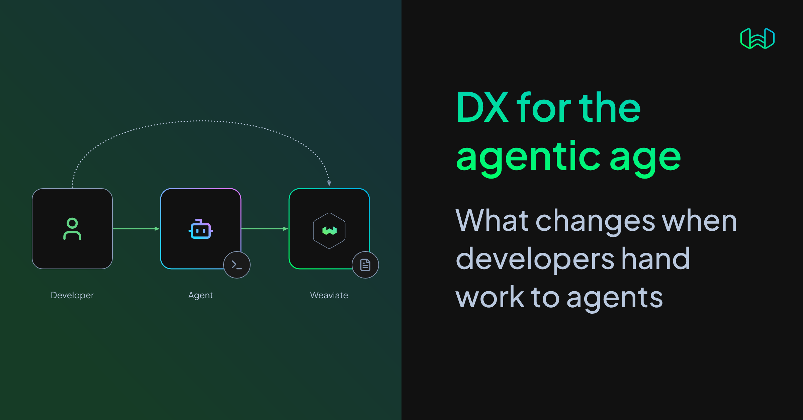

import ThemedImage from '@theme/ThemedImage';
import FetchToolsLight from './img/fetch-tools-light.png';
import FetchToolsDark from './img/fetch-tools-dark.png';
import DeveloperAgentLoopLight from './img/developer-agent-loop-light.png';
import DeveloperAgentLoopDark from './img/developer-agent-loop-dark.png';

When agents write the code, what is left for developers to do? We don't know for sure, but most would agree that there's no going back. Times, indeed, they are a-change-in.

And for a smaller group of us building developer tools - there's another question: what does it mean for developer experience (DX)?

We take care to craft API surfaces, documentation and learning material to guide developers to the right syntax, and help them discover the right tools.

Does any of it still matter when the primary audience is no longer human? It's easy to imagine that none of it would make a difference to our omniscient future overlords.

But here are two things that I think. One, we shouldn't forget that (at least for now) there is a human at the end of the agent, pulling the strings. So we should look to optimise *their* experience. And two, you might be surprised at how well good human DX translates to good results for agents.

Let me show tell you about a recent effort to improve our documentation. I found that in some cases, agents were drawing incorrect conclusions from our documentation. When we dug in, we traced the root cause to the fact that some agents were not receiving complete documentation pages! Pages were truncated, code examples missing for some languages , and sections missing.

And that missing context, we found, would send an agent searching elsewhere or lead it to incorrect conclusions or write wrong code. These issues had gone unnoticed because they affected a class of readers that rarely tells us when something is wrong: coding agents. And as a kicker - some of those issues would only exist for agents!

## The same page can look different to every agent

But how could we investigate what was causing these issues?

When it comes to identifying DX issues, we might have turned to user interviews. But you can't ask agents for feedback (*yet*). What we can do, however, is to simulate agent usage.

We set up several agents to run the same task in a repeatable way, and explore their logs and outputs. This let us see not only the final answers, but the paths they took to get there: what tools they used, what searches they ran, and what pages they read.

Sure, this identified documentation pages to update. But importantly, it showed us that agents should be treated as a different class of reader.

For one, agents do not read web pages in the same way as people using a browser. Fetch tools in different coding environments can return different parts of a page, and often do not tell the site when content is missing. But also, agents are read volumes of text in seconds, and will do their best to reconcile these differences.

But - and here's the important part - agents won't ask any followup questions. And they probably won't tell you, either.

So how would we make things better for those agents? I think we can follow the same process as above - by simulating agent usage, but this time - changing something about our site, and running them again. Running a controlled experiment, in other words.

In this case, we changed the pages' content and ran the tasks again. This let us measure whether a specific change helped agents get the context they needed.

For example, before our changes, one fetch tool returned the correct language examples in only 7 of 15 TypeScript runs and 3 of 15 Go runs. After the changes, it returned the right snippets in every run we checked.

<ThemedImage
  alt="Three coding-agent fetch tools return different amounts and sections of the same Weaviate documentation page"
  sources={{
    light: FetchToolsLight,
    dark: FetchToolsDark,
  }}
/>

We also found an outdated sentence on a concepts page that led agents to use an older client library, even though that page was not where the code examples lived. After we corrected it, every answer we checked used the current client.

When useful content is missing, agents may try to work around it by finding raw source files or downloading a page and writing a parser. In one example, an agent took 23 turns to reach a solution when the needed code was hidden; with the Markdown version of the page, it took 6. We also shipped Markdown versions of our documentation pages, reducing token use on page loads by around 20%.

These tests helped us catch regressions, too. A change that fixed hidden code tabs caused one fetch tool to return a section of the Quickstart while dropping the rest. Re-running the tests exposed the problem, and a small layout change fixed it.

## DX and agent experience work together

These are examples of agent experience (AX): making sure agents can use our docs, tools, and APIs effectively. As more work is delegated to agents, their experience matters alongside the experience of developers using those same resources directly.

The goal of DX has never been simply to make writing code faster. It is to reduce friction between a developer and the value they are trying to create. Code is one part of that. Developers still need to understand the problem, give agents good instructions, set up the right environment, and verify the result.

That means a good experience needs to serve both the developer and the agent working between the developer and the product:

<ThemedImage
  alt="A developer instructs and verifies a coding agent, which reads and interacts with Weaviate documentation, tools, clients, and APIs"
  sources={{
    light: DeveloperAgentLoopLight,
    dark: DeveloperAgentLoopDark,
  }}
/>

For developers, that means helping them make sound architectural decisions, communicate their intent to agents, and verify outcomes. For agents, it means making information complete and discoverable, providing agent-appropriate tools, reducing ambiguity, and making correctness observable.

Those goals align with Don Norman's ideas of the "gulf of execution" and "gulf of evaluation": people need to understand how to act and whether their actions worked. Agents change the interfaces and mechanisms involved, but those underlying needs remain.

## Turning the principles into practice

We are applying these ideas to the tools and workflows developers use with Weaviate. For example, when asked to update a Go service that uses the v5 client after GraphQL is disabled, some agents tried to call the server's gRPC API directly instead of looking for the newer [Go v6 client](https://docs.weaviate.io/weaviate/client-libraries/go). We are exploring ways to guide them toward the supported client with as little extra effort from the developer as possible.

We are also measuring how well agents can build Weaviate applications from scratch and adapt them to a developer's needs. That includes using current capabilities such as the [HFresh index](https://docs.weaviate.io/weaviate/concepts/vector-index#hfresh-index), [Rotational Quantization](https://docs.weaviate.io/weaviate/concepts/vector-quantization#rotational-quantization), and [PathSeer filtering](https://docs.weaviate.io/weaviate/concepts/filtering#pathseer), as well as applying the best practices we have learned.

Other work includes exploring what an agent-oriented Quickstart could look like, and how agents could help with cluster maintenance and troubleshooting.

## The principle stays the same

The core practice is familiar: find where people get stuck, improve the experience, and verify that the improvement worked. What has changed is the set of users and tools we need to measure. Developers now work through coding agents as well as IDEs and browsers, and agents rarely tell us when they could not find or understand something.

That makes measurement more important, not less. By testing how agents use our docs and tools before and after changes, we can reduce friction for both the developer and the agent—and help developers get more value from their work.

import WhatsNext from '/_includes/what-next.mdx';

<WhatsNext />
